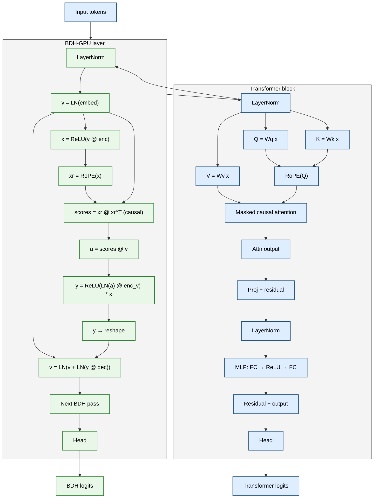

# Transformer vs BDH-GPU

This diagram compares the two architectures at the same abstraction level: both receive the same input representation, then process it through separate computation paths before producing their own logits.

## Key idea

- Transformer: explicit token-to-token attention with a growing KV cache.
- BDH-GPU: sparse key activations and recurrent-style memory read/write updates.
- The two models share the same input embedding path, but then branch into separate computational routines for easier comparison.

## Suggested filename

`transformer-vs-bdh-mermaid.md`
